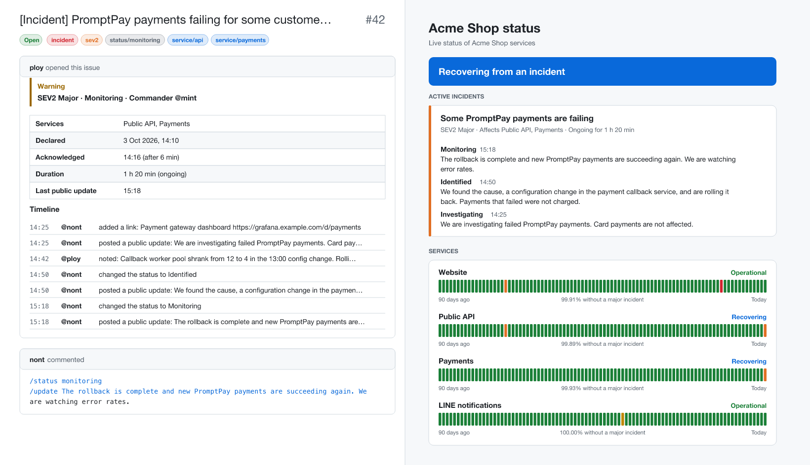

# incident-kit

English | [ภาษาไทย](README.th.md)

Incident management that lives in a GitHub repository. Declare an incident with an issue form, run it with slash commands in the comments, and get a public status page, on-call rotation, Slack/Discord/Teams/LINE alerts and a postmortem pull request at the end. No servers, no SaaS, no database.

[](https://github.com/nuttakulsv/incident-kit/actions/workflows/ci.yml)
[](LICENSE)
[](action.yml)



<sub>Left: an incident issue after a few commands. Right: the status page built from it. Fictional data from [examples/demo](examples/demo).</sub>

**[See the live status page](https://nuttakulsv.github.io/incident-kit/)** · **[Declare a demo incident](https://github.com/nuttakulsv/incident-kit/issues/new?template=incident.yml)** (this repository runs incident-kit on itself)

## Quick start

About five minutes:

1. Click **[Use this template](https://github.com/nuttakulsv/incident-kit-template/generate)**, or copy the template into an existing repository with `npx degit nuttakulsv/incident-kit/template`.
2. Edit `incident-kit.yml`: your services and who is on call. If you changed the services, run `npx incident-kit init` to refresh the issue form.
3. In the repository settings, set **Pages > Source** to **GitHub Actions**, and under **Actions > General** allow GitHub Actions to create pull requests (for postmortems).

That's it. Open a new issue with the **Declare an incident** form and comment `/help`.

## Why

Small and medium teams usually handle incidents in a chat thread. It works until someone asks a week later when the
outage started, who was in charge, what customers were told, and whether there is a postmortem. Paid incident tools
answer those questions well, but they are another subscription and another place to log in. The open-source option
most people found, Netflix Dispatch, needed its own servers and was archived in 2025.

Most engineering teams already live in GitHub. An issue has a thread, timestamps, assignees, labels, permissions, search
and an API. incident-kit adds the parts that turn an issue into an incident: roles, states, public updates, reminders,
a status page and a postmortem. Everything it knows comes from the issue, so there is nothing else to back up or keep
running.

## How it works

```
issue form ──▶ incident issue ──▶ GitHub Action ──▶ labels, assignee, status block
                    ▲                  │
   /status, /update │                  ├──▶ Slack, Discord, Teams, LINE, webhook
   in comments ─────┘                  ├──▶ status page on GitHub Pages
                                       └──▶ postmortem pull request when resolved
```

1. Someone opens an issue with the **Declare an incident** form: severity, affected services, a public title and what
   they know so far.
2. The Action labels it (`incident`, `sev2`, `status/investigating`, `service/payments`), assigns whoever is on call as
   incident commander, pins a status block to the top of the issue and sends notifications.
3. The team works in the comments. Anyone with write access can run commands; everything else is regular chat.
4. Every run rebuilds the incident from the whole thread. The status block carries a small snapshot of what was last
   announced, so re-running is safe and nothing is announced twice, even when GitHub skips a queued run.
5. When the incident is resolved, the Action closes the issue, posts the duration and time to acknowledge, and opens a
   pull request with a postmortem draft prefilled from the timeline.

## Commands

Commands go at the start of a line in an issue comment. Several in one comment are fine, and `/update` and `/note`
text can span multiple lines.

| Command                                                      | What it does                                                     |
| ------------------------------------------------------------ | ---------------------------------------------------------------- |
| `/status investigating` `identified` `monitoring` `resolved` | Move the incident to a new state. `/resolve` is a shortcut       |
| `/sev 2`                                                     | Change the severity, 1 is the worst                              |
| `/update <message>`                                          | Public update. Goes to the status page and to notifications      |
| `/note <message>`                                            | Internal note in the timeline. Never leaves GitHub               |
| `/title <text>`                                              | Change the title shown on the status page                        |
| `/services api payments`                                     | Set the affected services, using the ids from `incident-kit.yml` |
| `/assign @user`                                              | Hand over the incident commander role                            |
| `/link <url> [title]`                                        | Attach a dashboard, a log search or a pull request               |
| `/ack`                                                       | Acknowledge without changing anything else                       |
| `/help`                                                      | Post this list in the issue                                      |

A typical comment:

```text
/status identified
/update We found the cause, a configuration change in the payment callback service, and are rolling it back.
Payments that failed were not charged.
```

Typos get a reply instead of being ignored silently:

```text
I could not run part of that comment:

- /status "fixed" is not a state. Use one of: investigating, identified, monitoring, resolved
```

Closing the issue by hand resolves the incident, and reopening it puts it back to investigating.

## Configuration

`incident-kit.yml` in the root of the repository:

```yaml
title: Acme Shop status
description: Live status of Acme Shop services
# url: https://status.example.com   # defaults to the GitHub Pages URL of the repository
lang: en # en or th: comments, postmortems and the default page language
timezone: Asia/Bangkok # any IANA time zone

services:
  - id: website
    name: Website
  - id: payments
    name: Payments
    description: PromptPay and cards

severity:
  reminders: { 1: 15, 2: 30 } # minutes without a public update before the commander is reminded
  public: [1, 2, 3] # severities shown on the status page
  postmortem: [1, 2] # severities that get a postmortem pull request

oncall:
  rotation: [alice, bob, carol] # GitHub usernames, one week each
  start: 2026-01-05 # first handoff
  handoff: '10:00' # same weekday and time every week, in the time zone above
  overrides:
    - user: dave
      from: 2026-10-24
      to: 2026-10-27

notifications:
  - type: slack # slack, discord, teams, line or webhook
    webhook: SLACK_WEBHOOK_URL # name of the environment variable, never the URL itself
    severities: [1, 2, 3]
  - type: line
    token: LINE_CHANNEL_ACCESS_TOKEN
    to: LINE_TO # user, group or room id
    severities: [1, 2]
    events: [declared, resolved] # declared, severity, status, update, resolved
```

A broken config fails the run with every problem listed, not just the first one.

### Severity

| Level         | Meaning                                       | Default behaviour                         |
| ------------- | --------------------------------------------- | ----------------------------------------- |
| SEV1 Critical | Customers cannot use a core feature           | Public, reminder after 15 min, postmortem |
| SEV2 Major    | A core feature is degraded for many customers | Public, reminder after 30 min, postmortem |
| SEV3 Minor    | Limited impact, or there is a workaround      | Public                                    |
| SEV4 Low      | No customer impact yet                        | Internal only                             |

### On call

`incident-kit oncall` prints the schedule, overrides included:

```console
$ npx incident-kit oncall --weeks 4
28 Sept 2026, 10:00    → 5 Oct 2026, 10:00       @mint
5 Oct 2026, 10:00      → 12 Oct 2026, 10:00      @ploy
12 Oct 2026, 10:00     → 19 Oct 2026, 10:00      @nont
19 Oct 2026, 10:00     → 24 Oct 2026, 00:00      @mint
24 Oct 2026, 00:00     → 26 Oct 2026, 10:00      @aek
```

The handoff follows the local wall clock, so it stays at 10:00 across daylight saving changes. Without an `oncall`
section, whoever declares the incident becomes the commander.

### Notifications

Secrets stay in GitHub secrets and reach the Action as environment variables in `.github/workflows/incident-kit.yml`.
The config only names the variables. A missing secret skips that target with a notice in the log instead of failing
the run.

| Type      | What you need                                                                         |
| --------- | ------------------------------------------------------------------------------------- |
| `slack`   | An [incoming webhook](https://api.slack.com/messaging/webhooks) URL                   |
| `discord` | A channel webhook URL                                                                 |
| `teams`   | A Teams workflow webhook that accepts Adaptive Cards                                  |
| `line`    | A Messaging API channel access token and the id of the user, group or room to push to |
| `webhook` | Any URL. Receives `{ event, text, message, incident }` as JSON                        |

Text from the incident is escaped for Slack and sent with mentions disabled on Discord, so nobody can ping `@channel`
from an issue body.

## Status page

The `status-page` job rebuilds the site whenever a public incident changes, once a day, and when the config changes.
It has:

- an overall banner and the current state of every service
- active incidents with all their public updates
- a 90-day bar per service, with the share of time without a SEV1 or SEV2 incident
- past incidents grouped by day, one page per incident
- English and Thai versions, an Atom feed per language and `status.json` for other tools
- no JavaScript; it reloads itself every five minutes and works in any browser

From `npm run demo` in this repository:

```console
$ cat site/status.json
{
  "page": { "title": "Acme Shop status", "updatedAt": "2026-10-03T08:30:00.000Z", "timezone": "Asia/Bangkok", ... },
  "status": { "health": "monitoring", "description": "Recovering from an incident" },
  "services": [
    { "id": "website", "name": "Website", "health": "operational", "majorFree90d": 0.9991126543209876 },
    { "id": "api", "name": "Public API", "health": "monitoring", "majorFree90d": 0.9989969135802469 },
    ...
  ],
  "active": [ { "number": 42, "title": "Some PromptPay payments are failing", "severity": 2, "state": "monitoring", ... } ]
}
```

Only incidents from the team, with a severity listed in `severity.public`, are shown. Notes, usernames and the
internal summary never reach the page. For a custom domain, set it in the Pages settings and put the same address in
`url`.

## Postmortems

For severities in `severity.postmortem`, resolving the incident opens a pull request that adds
`docs/postmortems/2026-10-03-42-promptpay-payments-failing-for-some-customers.md`. The draft already has the impact window, time to
acknowledge, commander, everyone who took part and the full timeline. The team fills in the root cause, what went
well, what went wrong and the action items, and reviews it like any other pull request. The template is blameless and
available in English and Thai.

If the repository does not allow GitHub Actions to create pull requests, the draft is posted as a comment instead,
with a note on how to turn the setting on.

## Metrics

```console
$ npx incident-kit report --days 90 --demo examples/demo/incidents.json
## Incident report

Period: 5 Jul 2026 – 3 Oct 2026

| | |
| --- | --- |
| Incidents | 4 (1 still open) |
| Mean time to acknowledge | 2 min (median 1 min) |
| Mean time to resolve | 1 h 8 min (median 1 h 5 min) |
```

On a real repository use `--repo owner/name` instead of `--demo`. The full report adds counts by severity, by service
and by month, and a list of incidents. `--json` gives the raw numbers. In a scheduled workflow, `command: report` writes the same markdown to the job summary, which is handy for a
monthly retro.

## CLI

```text
incident-kit init [--lang en|th]          add the config, issue form, workflow and postmortem folder to this repo
incident-kit validate                     check incident-kit.yml and that the issue form matches it
incident-kit oncall [--weeks 8]           print the on-call schedule
incident-kit build-site [--out _site]     build the status page
incident-kit report [--days 30] [--json]  MTTA, MTTR and incident counts
```

`build-site` and `report` read incident issues with `--repo owner/name` (token from `GITHUB_TOKEN`, `GH_TOKEN` or the
`gh` CLI), or fictional ones with `--demo examples/demo/incidents.json`.

## Compared with

|                        | incident-kit                                          | [Netflix Dispatch](https://github.com/Netflix/dispatch) | PagerDuty, incident.io, FireHydrant | [Upptime](https://github.com/upptime/upptime) |
| ---------------------- | ----------------------------------------------------- | ------------------------------------------------------- | ----------------------------------- | --------------------------------------------- |
| Runs on                | GitHub Actions and Pages                              | Your servers, Postgres, a Slack app                     | Their cloud                         | GitHub Actions and Pages                      |
| Cost                   | Free on public repos, Actions minutes on private ones | Hosting                                                 | Per user per month                  | Free                                          |
| Paging by phone or SMS | No                                                    | Through PagerDuty                                       | Yes                                 | No                                            |
| Status page            | Yes                                                   | No                                                      | Yes                                 | Yes                                           |
| Uptime checks          | No                                                    | No                                                      | Some                                | Yes                                           |
| Maintained             | Yes                                                   | Archived in 2025                                        | Yes                                 | Yes                                           |

If you need to wake someone up at 3 a.m. with a phone call, use a paging service and let it open the incident issue
through the API. Upptime and incident-kit work well together: Upptime watches the endpoints, incident-kit runs the
response.

## FAQ and limitations

**How fast does it react?** As fast as GitHub starts the workflow job. That is normally quick, but GitHub gives no
guarantee and it can lag when Actions is busy. Scheduled reminders run every 30 minutes at best, and GitHub may delay
them too.

**What if GitHub itself is down?** Then the status page and the incident issues are down too. If GitHub is in your
critical path, keep a second channel for that case.

**Does it work in private repositories?** Yes. Actions minutes count against your plan, and GitHub Pages for private
repositories needs GitHub Pro, Team or Enterprise. The status page is public unless your Enterprise plan restricts it.

**Who can run commands?** People whose association with the repository is owner, member or collaborator. Reports from
anyone else are marked as unconfirmed: they stay off the status page and nobody is notified until a team member runs a
command. Their form fields are ignored, since the author can keep editing the issue; use `/sev`, `/services` and
`/title` to set them.

**Can I edit a past comment?** Yes, the next run picks it up, because the incident is always rebuilt from the thread.
That also means deleting a command comment removes it from the history.

**Scheduled workflows stopped running.** GitHub disables scheduled workflows in public repositories after 60 days
without activity. Any commit or a manual run turns them back on.

## Contributing

Bug reports, translations and pull requests are welcome. See [CONTRIBUTING.md](CONTRIBUTING.md).

## Acknowledgements

The incident roles and states follow common practice described in the
[PagerDuty incident response guide](https://response.pagerduty.com/) and the blameless postmortem chapter of Google's
[Site Reliability Engineering](https://sre.google/sre-book/postmortem-culture/) book. The idea of running operations
from GitHub Actions and Pages owes a lot to [Upptime](https://github.com/upptime/upptime). No code was copied from
these projects.

## License

[MIT](LICENSE)
