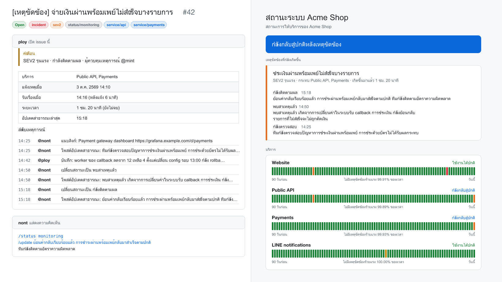

# incident-kit

[English](README.md) | ภาษาไทย

ระบบจัดการเหตุขัดข้อง (incident) ที่อยู่ใน GitHub repo ทั้งหมด แจ้งเหตุด้วย issue form สั่งงานด้วยคำสั่งในคอมเมนต์ แล้วได้หน้าสถานะสาธารณะ เวร on-call แจ้งเตือนเข้า Slack, Discord, Teams และ LINE ไปจนถึง pull request ร่าง postmortem ตอนจบ ไม่ต้องมีเซิร์ฟเวอร์ ไม่ต้องสมัคร SaaS ไม่ต้องมีฐานข้อมูล

[](https://github.com/nuttakulsv/incident-kit/actions/workflows/ci.yml)
[](LICENSE)
[](action.yml)



<sub>ซ้าย: issue ของเหตุขัดข้องหลังสั่งไปไม่กี่คำสั่ง ขวา: หน้าสถานะที่สร้างจาก issue นั้น ข้อมูลสมมติจาก [examples/demo](examples/demo)</sub>

**[ดูหน้าสถานะตัวอย่าง](https://nuttakulsv.github.io/incident-kit/th/)** · **[ลองแจ้งเหตุใน repo นี้](https://github.com/nuttakulsv/incident-kit/issues/new?template=incident.yml)** (repo นี้ใช้ incident-kit กับตัวเองด้วย)

## เริ่มใช้งาน

ใช้เวลาประมาณห้านาที

1. กด **[Use this template](https://github.com/nuttakulsv/incident-kit-template/generate)** หรือถ้ามี repo อยู่แล้ว คัดลอก template เข้าไปด้วย `npx degit nuttakulsv/incident-kit/template`
2. แก้ `incident-kit.yml` ใส่บริการของคุณและรายชื่อเวร on-call ถ้าแก้รายชื่อบริการ ให้รัน `npx incident-kit init` เพื่ออัปเดต issue form
3. ใน Settings ของ repo ตั้ง **Pages > Source** เป็น **GitHub Actions** และใน **Actions > General** อนุญาตให้ GitHub Actions สร้าง pull request ได้ (ใช้ตอนเปิด postmortem)

เท่านี้ก็พร้อมแล้ว ลองเปิด issue ใหม่ด้วยฟอร์ม **Declare an incident** แล้วคอมเมนต์ `/help` ดู

## ทำไมถึงทำตัวนี้

ทีมเล็กถึงกลางส่วนใหญ่รับมือเหตุขัดข้องกันในห้องแชต ซึ่งก็ใช้ได้ จนกระทั่งอาทิตย์ถัดมามีคนถามว่าระบบล่มตั้งแต่กี่โมง ใครเป็นคนคุมสถานการณ์ แจ้งลูกค้าไปว่าอะไร และมี postmortem หรือยัง เครื่องมือ incident แบบเสียเงินตอบคำถามพวกนี้ได้ดี แต่ก็เป็นค่าสมาชิกเพิ่มอีกตัวและอีกที่หนึ่งที่ต้อง login ส่วนตัว open source ที่คนรู้จักกันมากที่สุดอย่าง Netflix Dispatch ต้องตั้งเซิร์ฟเวอร์เอง และถูก archive ไปตั้งแต่ปี 2025

ทีม engineering ส่วนใหญ่อยู่ใน GitHub ทั้งวันอยู่แล้ว issue หนึ่งใบมีทั้งเธรด เวลา ผู้รับผิดชอบ label สิทธิ์ การค้นหา และ API ครบ incident-kit เติมส่วนที่ทำให้ issue กลายเป็น incident ได้แก่ บทบาท สถานะ อัปเดตสาธารณะ การเตือน หน้าสถานะ และ postmortem ข้อมูลทุกอย่างมาจาก issue จึงไม่มีอะไรต้อง backup หรือต้องดูแลให้รันอยู่ตลอด

## ทำงานยังไง

```
issue form ──▶ issue ของเหตุขัดข้อง ──▶ GitHub Action ──▶ label, ผู้รับผิดชอบ, กล่องสถานะ
                    ▲                        │
   /status, /update │                        ├──▶ Slack, Discord, Teams, LINE, webhook
   ในคอมเมนต์ ──────┘                        ├──▶ หน้าสถานะบน GitHub Pages
                                             └──▶ pull request ร่าง postmortem ตอนแก้เสร็จ
```

1. มีคนเปิด issue ด้วยฟอร์ม **Declare an incident** กรอกระดับความรุนแรง บริการที่ได้รับผลกระทบ หัวข้อที่จะแสดงต่อลูกค้า และสิ่งที่รู้ตอนนั้น
2. Action ติด label ให้ (`incident`, `sev2`, `status/investigating`, `service/payments`) มอบหมายคนที่อยู่เวร on-call เป็นผู้ควบคุมเหตุการณ์ (incident commander) ปักกล่องสถานะไว้บนสุดของ issue แล้วส่งแจ้งเตือน
3. ทีมคุยกันในคอมเมนต์ตามปกติ คนที่มีสิทธิ์เขียน repo สั่งคำสั่งได้ ข้อความอื่นถือเป็นแชตธรรมดา
4. ทุกครั้งที่รัน Action จะคำนวณสถานะใหม่จากเธรดทั้งหมด และกล่องสถานะเก็บ snapshot เล็ก ๆ ของสิ่งที่ประกาศไปแล้ว รันซ้ำกี่รอบก็ไม่ประกาศซ้ำ แม้ GitHub จะข้ามบางรอบที่ต่อคิวอยู่ก็ตาม
5. พอแก้เสร็จ Action ปิด issue สรุประยะเวลาและเวลาที่ใช้กว่าจะรับเรื่อง แล้วเปิด pull request ร่าง postmortem ที่เติมลำดับเหตุการณ์ไว้ให้แล้ว

## คำสั่ง

คำสั่งต้องขึ้นต้นบรรทัดในคอมเมนต์ของ issue ใส่หลายคำสั่งในคอมเมนต์เดียวได้ และข้อความของ `/update` กับ `/note` ยาวหลายบรรทัดได้

| คำสั่ง                                                       | ใช้ทำอะไร                                                |
| ------------------------------------------------------------ | -------------------------------------------------------- |
| `/status investigating` `identified` `monitoring` `resolved` | เปลี่ยนสถานะ หรือพิมพ์ `/resolve` สั้น ๆ ก็ได้           |
| `/sev 2`                                                     | เปลี่ยนระดับความรุนแรง 1 คือรุนแรงที่สุด                 |
| `/update <ข้อความ>`                                          | อัปเดตสาธารณะ ขึ้นหน้าสถานะและส่งแจ้งเตือน               |
| `/note <ข้อความ>`                                            | บันทึกภายในลงลำดับเหตุการณ์ ไม่ออกไปนอก GitHub           |
| `/title <ข้อความ>`                                           | เปลี่ยนหัวข้อที่แสดงบนหน้าสถานะ                          |
| `/services api payments`                                     | ตั้งบริการที่ได้รับผลกระทบ ใช้ id จาก `incident-kit.yml` |
| `/assign @user`                                              | ส่งต่อบทบาทผู้ควบคุมเหตุการณ์                            |
| `/link <url> [ชื่อ]`                                         | แนบลิงก์ dashboard, log หรือ pull request                |
| `/ack`                                                       | รับเรื่องโดยไม่เปลี่ยนอย่างอื่น                          |
| `/help`                                                      | แสดงรายการคำสั่งใน issue                                 |

ตัวอย่างคอมเมนต์

```text
/status identified
/update พบสาเหตุแล้ว เกิดจากการเปลี่ยนค่าในระบบรับ callback การชำระเงิน กำลังย้อนกลับ
รายการที่ไม่สำเร็จจะไม่ถูกตัดเงิน
```

พิมพ์ผิดจะมีคำตอบกลับมา ไม่ใช่เงียบหายไปเฉย ๆ

```text
บางคำสั่งในคอมเมนต์นี้ทำไม่ได้:

- /status "fixed" is not a state. Use one of: investigating, identified, monitoring, resolved
```

ปิด issue เองก็ถือว่าแก้ไขแล้ว และถ้าเปิด issue กลับมาใหม่ สถานะจะกลับเป็นกำลังตรวจสอบ

## การตั้งค่า

ไฟล์ `incident-kit.yml` อยู่ที่ root ของ repo

```yaml
title: สถานะระบบ Acme Shop
description: สถานะการให้บริการของ Acme Shop
# url: https://status.example.com   # ถ้าไม่ใส่จะใช้ URL ของ GitHub Pages
lang: th # en หรือ th ใช้กับคอมเมนต์ postmortem และภาษาหลักของหน้าสถานะ
timezone: Asia/Bangkok # ใช้ชื่อ time zone แบบ IANA

services:
  - id: website
    name: Website
  - id: payments
    name: Payments
    description: พร้อมเพย์และบัตร

severity:
  reminders: { 1: 15, 2: 30 } # ไม่มีอัปเดตสาธารณะกี่นาทีแล้วจะเตือนผู้ควบคุมเหตุการณ์
  public: [1, 2, 3] # ระดับที่แสดงบนหน้าสถานะ
  postmortem: [1, 2] # ระดับที่จะเปิด pull request ร่าง postmortem

oncall:
  rotation: [alice, bob, carol] # GitHub username คนละหนึ่งสัปดาห์
  start: 2026-01-05 # วันส่งเวรครั้งแรก
  handoff: '10:00' # ส่งเวรวันเดิมเวลาเดิมทุกสัปดาห์ ตาม time zone ข้างบน
  overrides:
    - user: dave
      from: 2026-10-24
      to: 2026-10-27

notifications:
  - type: slack # slack, discord, teams, line หรือ webhook
    webhook: SLACK_WEBHOOK_URL # ชื่อ environment variable ห้ามใส่ URL ลงไปตรง ๆ
    severities: [1, 2, 3]
  - type: line
    token: LINE_CHANNEL_ACCESS_TOKEN
    to: LINE_TO # id ของ user, group หรือ room
    severities: [1, 2]
    events: [declared, resolved] # declared, severity, status, update, resolved
```

ถ้าไฟล์ตั้งค่าผิด Action จะหยุดและบอกปัญหาครบทุกข้อในครั้งเดียว

### ระดับความรุนแรง

| ระดับ         | ความหมาย                                 | ค่าเริ่มต้น                                   |
| ------------- | ---------------------------------------- | --------------------------------------------- |
| SEV1 วิกฤต    | ลูกค้าใช้งานฟีเจอร์หลักไม่ได้            | ขึ้นหน้าสถานะ เตือนหลัง 15 นาที มี postmortem |
| SEV2 รุนแรง   | ฟีเจอร์หลักทำงานผิดปกติกับลูกค้าจำนวนมาก | ขึ้นหน้าสถานะ เตือนหลัง 30 นาที มี postmortem |
| SEV3 เล็กน้อย | กระทบบางส่วน หรือมีทางเลี่ยง             | ขึ้นหน้าสถานะ                                 |
| SEV4 ต่ำ      | ยังไม่กระทบลูกค้า                        | ใช้ภายในเท่านั้น                              |

### เวร on-call

`incident-kit oncall` แสดงตารางเวรรวมการสลับเวรไว้ด้วย

```console
$ npx incident-kit oncall --weeks 4
28 Sept 2026, 10:00    → 5 Oct 2026, 10:00       @mint
5 Oct 2026, 10:00      → 12 Oct 2026, 10:00      @ploy
12 Oct 2026, 10:00     → 19 Oct 2026, 10:00      @nont
19 Oct 2026, 10:00     → 24 Oct 2026, 00:00      @mint
24 Oct 2026, 00:00     → 26 Oct 2026, 10:00      @aek
```

เวลาส่งเวรยึดตามนาฬิกาท้องถิ่น ทีมที่อยู่ในประเทศที่มี daylight saving ก็ยังส่งเวรตอน 10:00 เหมือนเดิม ถ้าไม่ได้ตั้ง `oncall` คนที่แจ้งเหตุจะเป็นผู้ควบคุมเหตุการณ์เอง

### การแจ้งเตือน

secret เก็บไว้ใน GitHub secrets แล้วส่งให้ Action เป็น environment variable ในไฟล์ `.github/workflows/incident-kit.yml` ส่วนไฟล์ตั้งค่าเก็บแค่ชื่อตัวแปร ถ้าตัวไหนยังไม่ได้ตั้ง secret ระบบจะข้ามช่องทางนั้นและเขียนไว้ใน log ไม่ทำให้ทั้งรอบพัง

| ประเภท    | ต้องเตรียมอะไร                                                                     |
| --------- | ---------------------------------------------------------------------------------- |
| `slack`   | URL ของ [incoming webhook](https://api.slack.com/messaging/webhooks)               |
| `discord` | URL ของ webhook ในห้องที่ต้องการ                                                   |
| `teams`   | webhook จาก Teams workflow ที่รับ Adaptive Card                                    |
| `line`    | channel access token ของ Messaging API และ id ของ user, group หรือ room ที่จะส่งไป |
| `webhook` | URL อะไรก็ได้ จะได้รับ `{ event, text, message, incident }` เป็น JSON              |

ข้อความจาก incident จะถูก escape ก่อนส่งเข้า Slack และส่งเข้า Discord โดยปิดการ mention ไว้ ใครพิมพ์ `@channel` ไว้ใน issue ก็ไม่ไปปลุกทั้งห้อง

## หน้าสถานะ

job `status-page` สร้างเว็บใหม่ทุกครั้งที่เหตุขัดข้องสาธารณะมีการเปลี่ยนแปลง วันละครั้ง และตอนแก้ไฟล์ตั้งค่า ในหน้ามี

- แถบสถานะรวมด้านบน และสถานะปัจจุบันของแต่ละบริการ
- เหตุขัดข้องที่กำลังเกิด พร้อมอัปเดตสาธารณะทั้งหมด
- แถบย้อนหลัง 90 วันของแต่ละบริการ พร้อมสัดส่วนเวลาที่ไม่มีเหตุระดับ SEV1 หรือ SEV2
- เหตุขัดข้องที่ผ่านมาแยกตามวัน และหน้าแยกของแต่ละเหตุการณ์
- ภาษาไทยและอังกฤษ, Atom feed แยกภาษา และ `status.json` ให้ระบบอื่นดึงไปใช้
- ไม่ใช้ JavaScript รีเฟรชตัวเองทุกห้านาที เปิดได้ทุกเบราว์เซอร์

ผลจาก `npm run demo` ใน repo นี้

```console
$ cat site/status.json
{
  "page": { "title": "Acme Shop status", "updatedAt": "2026-10-03T08:30:00.000Z", "timezone": "Asia/Bangkok", ... },
  "status": { "health": "monitoring", "description": "Recovering from an incident" },
  "services": [
    { "id": "website", "name": "Website", "health": "operational", "majorFree90d": 0.9991126543209876 },
    { "id": "api", "name": "Public API", "health": "monitoring", "majorFree90d": 0.9989969135802469 },
    ...
  ],
  "active": [ { "number": 42, "title": "Some PromptPay payments are failing", "severity": 2, "state": "monitoring", ... } ]
}
```

หน้าสถานะแสดงเฉพาะเหตุการณ์ที่ทีมยืนยันแล้ว และมีระดับอยู่ใน `severity.public` เท่านั้น บันทึกภายใน ชื่อผู้ใช้ และสรุปภายในจะไม่ขึ้นบนหน้าเว็บ ถ้าจะใช้โดเมนของตัวเอง ให้ตั้งใน Pages settings แล้วใส่ที่อยู่เดียวกันใน `url`

## Postmortem

ระดับที่อยู่ใน `severity.postmortem` เมื่อแก้เสร็จจะได้ pull request ที่เพิ่มไฟล์ `docs/postmortems/2026-10-03-42-promptpay-payments-failing-for-some-customers.md` ในร่างมีช่วงเวลาที่กระทบ เวลากว่าจะรับเรื่อง ผู้ควบคุมเหตุการณ์ รายชื่อทุกคนที่เข้ามาช่วย และลำดับเหตุการณ์ครบ ทีมเติมแค่สาเหตุ สิ่งที่ทำได้ดี สิ่งที่ยังไม่ดี และงานที่ต้องทำต่อ แล้วรีวิวเหมือน pull request ปกติ template เขียนแบบไม่หาคนผิด (blameless) มีทั้งภาษาไทยและอังกฤษ

ถ้า repo ไม่อนุญาตให้ GitHub Actions สร้าง pull request ร่างจะถูกโพสต์เป็นคอมเมนต์แทน พร้อมบอกวิธีเปิดสิทธิ์

## ตัวชี้วัด

```console
$ npx incident-kit report --days 90 --demo examples/demo/incidents.json
## Incident report

Period: 5 Jul 2026 – 3 Oct 2026

| | |
| --- | --- |
| Incidents | 4 (1 still open) |
| Mean time to acknowledge | 2 min (median 1 min) |
| Mean time to resolve | 1 h 8 min (median 1 h 5 min) |
```

ใช้กับ repo จริงให้เปลี่ยน `--demo` เป็น `--repo owner/name` รายงานเต็มมีจำนวนแยกตามระดับ ตามบริการ และตามเดือน พร้อมรายการเหตุการณ์ `--json` ให้ตัวเลขดิบ และถ้าตั้งเป็น workflow รายเดือนด้วย `command: report` จะได้รายงานเดียวกันใน job summary เอาไปใช้ตอน retro ได้เลย ถ้าตั้ง `lang: th` รายงานจะออกมาเป็นภาษาไทย

## CLI

```text
incident-kit init [--lang en|th]          add the config, issue form, workflow and postmortem folder to this repo
incident-kit validate                     check incident-kit.yml and that the issue form matches it
incident-kit oncall [--weeks 8]           print the on-call schedule
incident-kit build-site [--out _site]     build the status page
incident-kit report [--days 30] [--json]  MTTA, MTTR and incident counts
```

`build-site` กับ `report` อ่าน issue จริงด้วย `--repo owner/name` (ใช้ token จาก `GITHUB_TOKEN`, `GH_TOKEN` หรือ `gh` CLI) หรืออ่านข้อมูลสมมติด้วย `--demo examples/demo/incidents.json`

## เทียบกับตัวอื่น

|                     | incident-kit                                          | [Netflix Dispatch](https://github.com/Netflix/dispatch) | PagerDuty, incident.io, FireHydrant | [Upptime](https://github.com/upptime/upptime) |
| ------------------- | ----------------------------------------------------- | ------------------------------------------------------- | ----------------------------------- | --------------------------------------------- |
| รันที่ไหน           | GitHub Actions และ Pages                              | เซิร์ฟเวอร์ของคุณ, Postgres, Slack app                  | คลาวด์ของผู้ให้บริการ               | GitHub Actions และ Pages                      |
| ค่าใช้จ่าย          | ฟรีใน repo สาธารณะ ใน repo ส่วนตัวใช้ Actions minutes | ค่าเซิร์ฟเวอร์                                          | ต่อผู้ใช้ต่อเดือน                   | ฟรี                                           |
| โทรหรือส่ง SMS ปลุก | ไม่มี                                                 | ผ่าน PagerDuty                                          | มี                                  | ไม่มี                                         |
| หน้าสถานะ           | มี                                                    | ไม่มี                                                   | มี                                  | มี                                            |
| ตรวจ uptime         | ไม่มี                                                 | ไม่มี                                                   | บางเจ้า                             | มี                                            |
| ยังพัฒนาต่อ         | ใช่                                                   | archive ไปเมื่อปี 2025                                  | ใช่                                 | ใช่                                           |

ถ้าต้องโทรปลุกคนตอนตีสาม ให้ใช้บริการ paging แล้วให้บริการนั้นเปิด issue ผ่าน API แทน ส่วน Upptime ใช้คู่กันได้ดี Upptime เฝ้า endpoint แล้ว incident-kit จัดการการรับมือ

## คำถามที่พบบ่อยและข้อจำกัด

**ตอบสนองเร็วแค่ไหน** เร็วเท่าที่ GitHub เริ่ม job ของ workflow ปกติก็เร็ว แต่ GitHub ไม่รับประกัน ช่วงที่ Actions คนใช้เยอะอาจช้าลง ส่วนการเตือนตามเวลารันอย่างเร็วทุก 30 นาที และ GitHub อาจเลื่อนออกไปได้เหมือนกัน

**ถ้า GitHub ล่มเองล่ะ** หน้าสถานะและ issue ก็ล่มไปด้วย ถ้า GitHub อยู่ในเส้นทางสำคัญของระบบคุณ ควรมีช่องทางสำรองไว้สำหรับกรณีนั้น

**ใช้กับ repo ส่วนตัวได้ไหม** ได้ Actions minutes จะนับตามแพ็กเกจของคุณ และ GitHub Pages สำหรับ repo ส่วนตัวต้องใช้ GitHub Pro, Team หรือ Enterprise หน้าสถานะจะเป็นสาธารณะ เว้นแต่แพ็กเกจ Enterprise ตั้งให้จำกัดการเข้าถึง

**ใครสั่งคำสั่งได้บ้าง** คนที่เป็น owner, member หรือ collaborator ของ repo ถ้าคนอื่นแจ้งเหตุเข้ามา เหตุนั้นจะถูกมาร์กว่ายังไม่ยืนยัน ไม่ขึ้นหน้าสถานะและไม่แจ้งเตือนใคร จนกว่าคนในทีมจะสั่งคำสั่งใดก็ได้ ข้อมูลในฟอร์มของคนนอกจะไม่ถูกใช้ เพราะเจ้าของ issue แก้ไขต่อได้เรื่อย ๆ ให้ใช้ `/sev`, `/services` และ `/title` ตั้งค่าแทน

**แก้คอมเมนต์เก่าได้ไหม** ได้ รอบถัดไปจะเห็นการแก้ไข เพราะสถานะคำนวณใหม่จากเธรดทุกครั้ง แปลว่าถ้าลบคอมเมนต์ที่มีคำสั่ง ประวัติส่วนนั้นก็หายไปด้วย

**workflow ตามเวลาหยุดทำงาน** GitHub ปิด scheduled workflow ใน repo สาธารณะที่ไม่มีความเคลื่อนไหว 60 วัน commit อะไรก็ได้หรือสั่งรันเองหนึ่งครั้งก็กลับมาทำงาน

## ร่วมพัฒนา

ยินดีรับทั้ง bug report, คำแปล และ pull request ดูรายละเอียดที่ [CONTRIBUTING.md](CONTRIBUTING.md)

## ขอบคุณ

บทบาทและสถานะของเหตุการณ์อ้างอิงแนวทางที่ใช้กันทั่วไปจาก [PagerDuty incident response guide](https://response.pagerduty.com/) และบท blameless postmortem ในหนังสือ [Site Reliability Engineering](https://sre.google/sre-book/postmortem-culture/) ของ Google แนวคิดการทำงาน ops ด้วย GitHub Actions และ Pages ได้แรงบันดาลใจจาก [Upptime](https://github.com/upptime/upptime) ไม่ได้คัดลอกโค้ดจากโปรเจกต์เหล่านี้

## License

[MIT](LICENSE)
